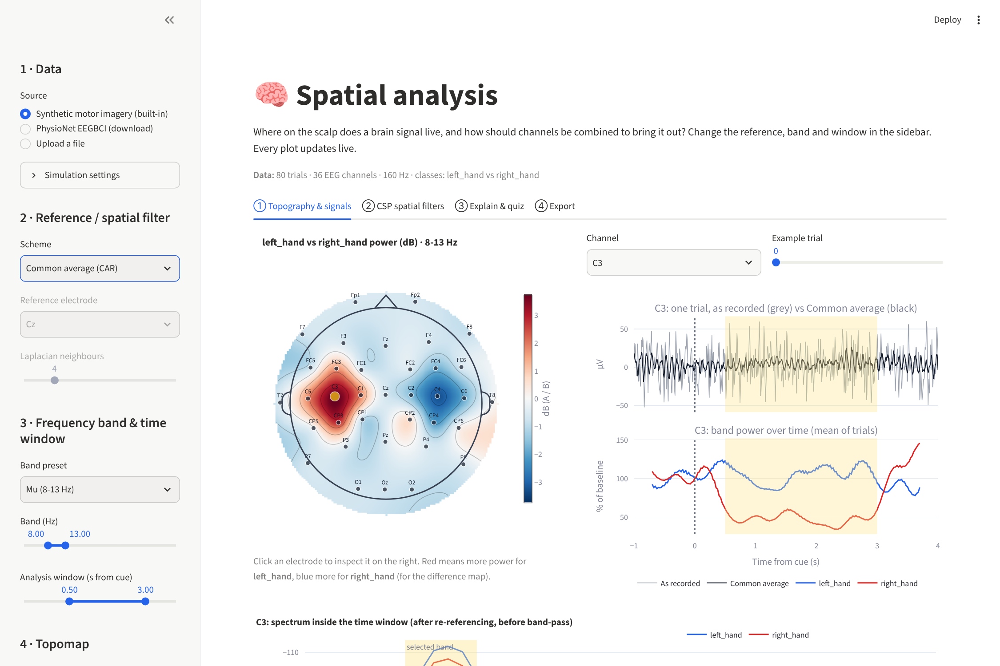

# 🧠 Spatial Analysis: BCI teaching module

**Course:** Brain–Computer Interfaces (CS5109), IIITDM Kancheepuram · Option A, web-app module  
**Team SYNAPSE:** Skanda S Bhat (CS22B1067) · Krishan Kant Mishra (CS22B1031)  
**Repository:** <https://github.com/krishna385/BCI-project>

An interactive Streamlit module that teaches **spatial analysis of EEG**: why the
reference matters, what a scalp topography shows, how Laplacian filters sharpen
local activity, and how **Common Spatial Patterns (CSP)** learn the best channel
combination for a motor-imagery BCI.



---

## Run it

```bash
pip install -r requirements.txt && streamlit run app.py
```

The app opens at <http://localhost:8501>. It needs Python 3.10 or newer and no
data download. The built-in sample dataset is simulated on the fly.

On a clean machine, a virtual environment keeps things tidy:

```bash
git clone https://github.com/krishna385/BCI-project.git && cd BCI-project
python3 -m venv .venv && source .venv/bin/activate      # Windows: .venv\Scripts\activate
pip install -r requirements.txt && streamlit run app.py
```

Run the tests with:

```bash
pytest
```

---

## What the module covers

| Requirement from the brief | Where it is in the app |
|---|---|
| Sample data + own file upload | Sidebar → **1 · Data**: built-in simulated motor imagery, PhysioNet EEGBCI (download), or upload `.fif / .edf / .bdf / .gdf / .set` |
| 5+ adjustable parameters | Reference scheme, reference electrode, Laplacian neighbours, frequency band, time window, topomap metric, CSP channels, CSP components, regularisation, shrinkage, example trial, plus 5 simulation settings |
| 2 linked, live-updating plots | **Topomap ↔ channel view**: click an electrode and the trial trace, ERD time course and spectrum switch to it. All plots react to every sidebar change |
| "Explain" panel with questions | Tab **③ Explain & quiz**: notes that react to your current settings, concept cards and 6 self-check questions with feedback |
| Export of code and parameters | Tab **④ Export**: parameters as JSON (and re-import), plus a runnable Python script |
| One-line run command | `pip install -r requirements.txt && streamlit run app.py` |
| At least 3 automated tests | 24 tests in `tests/` (`pytest`) |

## Repository layout

```
app.py                     stand-alone entry point (streamlit run app.py)
spatial_module/
  ui.py                    Streamlit page, render() is the hook for the course app
  data.py                  synthetic data, PhysioNet loader, file upload, epoching
  processing.py            references, Laplacians, CSD, filtering, band power, CSP
  plots.py                 Plotly topomaps and linked signal plots
  explain.py               explain-panel text and quiz questions
  export.py                JSON and Python-script export
tests/                     pytest suite (processing, app, upload, export)
docs/USER_GUIDE.md         how to use the module, with suggested experiments
docs/DEVELOPER_GUIDE.md    architecture, how to extend, how it plugs into the course app
```

## Data

* **Synthetic motor imagery** (default). 36 electrodes, 160 Hz, left vs right hand.
  Mu-rhythm sources sit under C3 and C4 and show contralateral ERD 0.5–3 s after the cue.
  The recording also has a noisy reference (shared by all channels) and a strong occipital
  alpha source, so the effect of each reference scheme is visible. The ground truth is
  known, which makes it good for teaching.
* **PhysioNet EEG Motor Movement/Imagery** (Schalk et al., 2004; Goldberger et al., 2000),
  runs 4, 8 and 12. Downloaded through `mne.datasets.eegbci` on first use (internet needed once).
* **Your own file**: any continuous recording with two event types, or an `-epo.fif`.
  Channels are matched to standard 10-20 positions when the file has no montage.
  `python -m spatial_module.data` writes `sample_data/synthetic_mi_raw.fif` so you can try this path.

## References

* Hjorth, B. (1975). An on-line transformation of EEG scalp potentials into orthogonal source derivations. *EEG and Clinical Neurophysiology*, 39(5), 526–530.
* McFarland, D. J., et al. (1997). Spatial filter selection for EEG-based communication. *EEG and Clinical Neurophysiology*, 103(3), 386–394.
* Perrin, F., et al. (1989). Spherical splines for scalp potential and current density mapping. *EEG and Clinical Neurophysiology*, 72(2), 184–187.
* Pfurtscheller, G., & Lopes da Silva, F. H. (1999). Event-related EEG/MEG synchronization and desynchronization. *Clinical Neurophysiology*, 110(11), 1842–1857.
* Ramoser, H., Müller-Gerking, J., & Pfurtscheller, G. (2000). Optimal spatial filtering of single trial EEG during imagined hand movement. *IEEE Trans. Rehab. Eng.*, 8(4), 441–446.
* Blankertz, B., et al. (2008). Optimizing spatial filters for robust EEG single-trial analysis. *IEEE Signal Processing Magazine*, 25(1), 41–56.
* Haufe, S., et al. (2014). On the interpretation of weight vectors of linear models in multivariate neuroimaging. *NeuroImage*, 87, 96–110.
* Combrisson, E., & Jerbi, K. (2015). Exceeding chance level by chance. *J. Neurosci. Methods*, 250, 126–136.
* Gramfort, A., et al. (2013). MEG and EEG data analysis with MNE-Python. *Frontiers in Neuroscience*, 7, 267.
* Schalk, G., et al. (2004). BCI2000: a general-purpose brain-computer interface system. *IEEE Trans. Biomed. Eng.*, 51(6), 1034–1043.

## Tools and AI use

Built with MNE-Python, scikit-learn, SciPy, Plotly and Streamlit. An AI assistant
(Claude, by Anthropic) helped draft parts of the code and documentation. The team
reviewed, tested and is responsible for all of it.
