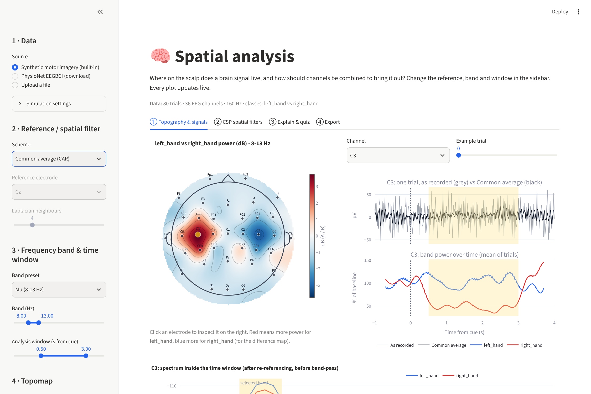
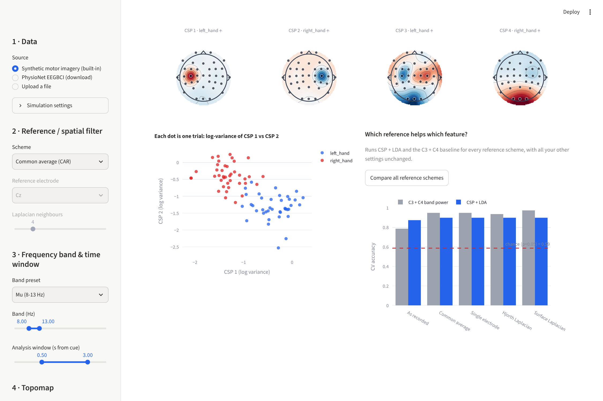
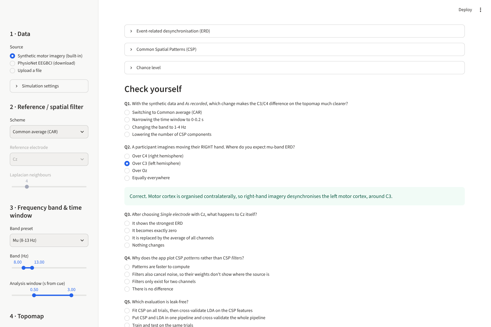
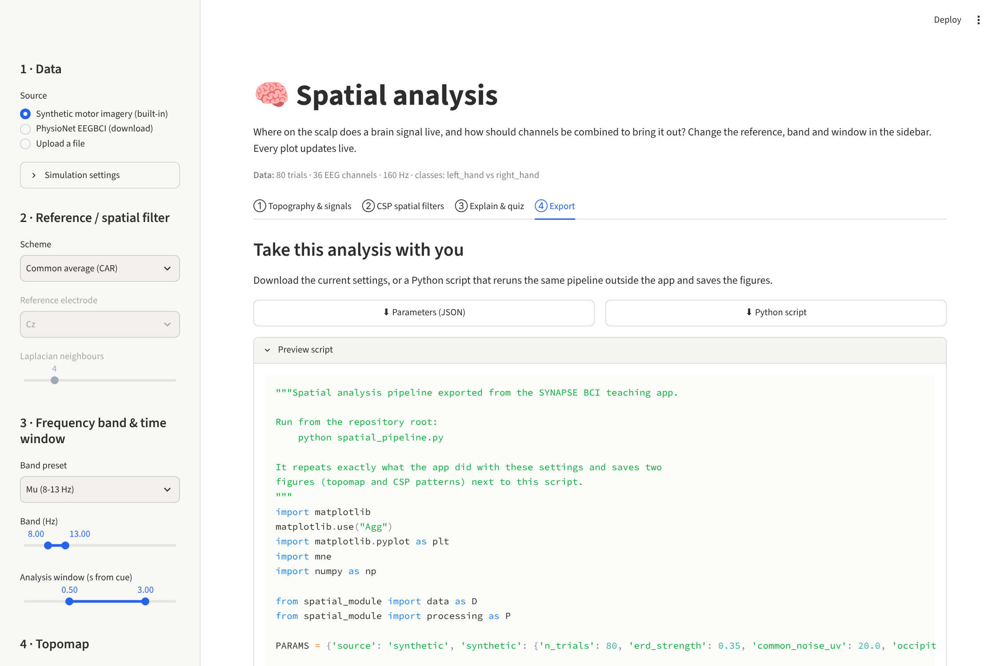

# User guide: Spatial Analysis module

This guide is for students using the module. You don't need to read any code.

## 1. Start the app

```bash
pip install -r requirements.txt && streamlit run app.py
```

Your browser opens the app. The sidebar on the left has every control, and the
main area has four tabs. All plots update as soon as you change something.

## 2. The sidebar, step by step

### 1 · Data
| Option | What it is |
|---|---|
| **Synthetic motor imagery (built-in)** | Simulated EEG from 36 electrodes: 80 trials of imagined left-hand vs right-hand movement. Ready instantly. |
| **PhysioNet EEGBCI (download)** | Real EEG from the PhysioNet Motor Movement/Imagery dataset. Pick a subject from 1 to 109. The first load downloads about 7 MB. |
| **Upload a file** | Your own `.fif`, `.edf`, `.bdf`, `.gdf` or `.set` file. Choose which two event types to compare (Class A and Class B) and the epoch length. |

The **Simulation settings** expander lets you change the simulated data:

* **ERD strength**: how much the mu rhythm drops during imagery. Smaller values make the task harder.
* **Noisy-reference amplitude**: noise that appears on *every* channel, as if the reference electrode were loose.
* **Occipital alpha amplitude**: a strong rhythm at the back of the head that has nothing to do with the task.
* **Trials** and **Random seed**.

### 2 · Reference / spatial filter
Choose how each channel is re-expressed:

* **As recorded**: the original reference, unchanged.
* **Common average (CAR)**: subtract the mean of all channels.
* **Single electrode**: subtract one electrode (pick it below). That electrode becomes zero.
* **Hjorth Laplacian**: subtract the average of each electrode's nearest neighbours (choose how many).
* **Surface Laplacian (CSD)**: spherical-spline current source density, the most local view.

### 3 · Frequency band & time window

* **Band preset** or drag the **Band (Hz)** slider. Mu (8–13 Hz) is where the motor-imagery effect lives.
* **Analysis window**: the time after the cue that is analysed (the yellow shading in the plots).

### 4 · Topomap
What the scalp map shows: the **class difference in dB**, **ERD %** for one class
(power change compared with the −1 to 0 s baseline), or raw **band power** for one class.

### 5 · CSP

* **Channels for CSP**: all channels, the sensorimotor strip, or your own selection.
* **Components**: how many CSP filters to keep (pairs from both ends).
* **Covariance regularisation**: None, Ledoit-Wolf, OAS, or manual shrinkage. Useful with few trials.

## 3. The tabs

### ① Topography & signals (the linked plots)



* **Left, the topomap.** Each dot is an electrode. **Click any electrode** to inspect it.
* **Right, the channel view** for the selected electrode:
  * *Top:* one trial before (grey) and after (black) re-referencing. Use the **Example trial** slider to browse trials.
  * *Bottom:* band power over time, averaged per class, as a % of baseline. A dip inside the yellow window is ERD.
* **Below, the spectrum** of that electrode per class, with the selected band shaded.

### ② CSP spatial filters



* Four scores: **CSP + LDA accuracy**, a simple **C3 + C4 band-power** classifier for comparison, the **chance level** for your number of trials, and the number of channels used. Every accuracy is 5-fold cross-validated, with CSP fitted inside each fold so nothing leaks.
* **CSP patterns**: where each learned component lives on the scalp.
* **Scatter plot**: every trial placed by its first two CSP features. Two well-separated clouds mean the classes are easy to tell apart.
* **Compare all reference schemes**: runs both classifiers under every reference so you can see which one helps.

### ③ Explain & quiz



Notes that react to your current settings, short concept cards, and six questions with instant feedback.

### ④ Export



* **Parameters (JSON)**: saves every setting. Upload it again later to restore them.
* **Python script**: reruns the exact same pipeline outside the app (run it from the repository folder) and saves the topomap and CSP-pattern figures as PNG files.

## 4. Five experiments to try

1. **Kill the noisy reference.** Start with *As recorded* and look at the topomap. Switch to *Common average*. The C3 (red) / C4 (blue) contrast jumps from about ±1 dB to about ±3 dB, and the C3 + C4 accuracy on the CSP tab rises.
2. **Break it with a bad reference.** Choose *Single electrode* and pick **C3** as the reference. C3 becomes zero and the left-hemisphere effect is gone. Lesson: never reference to a site you care about.
3. **Laplacian vs broad alpha.** In Simulation settings, raise the occipital alpha to 30 µV, set the band to *Alpha (8–12 Hz)* and show *Band power – class A*. Under CAR the back of the head dominates the map. Under the Hjorth Laplacian the broad occipital alpha is suppressed, and the focal mu over C3/C4 stands out much more (C3 rises from roughly a sixth to about 40 % of Oz's power).
4. **Wrong band, wrong time.** Move the band to 30–40 Hz, or the window to −1–0 s. The class difference fades and the accuracy falls towards chance.
5. **Few trials.** Set Trials to 20. The chance level climbs to 70 %, and an accuracy that looked good before may no longer be meaningful. Try Ledoit-Wolf regularisation.

## 5. Troubleshooting
| Problem | Fix |
|---|---|
| `streamlit: command not found` | Run `python -m streamlit run app.py` |
| PhysioNet fails to load | You need internet the first time. Try another subject, or use the synthetic data |
| Upload says fewer than 8 channels have positions | Rename channels to standard 10-20 names (C3, Cz, ...) or save the file with a montage |
| Upload says it needs two event types | The recording needs annotations or a stim channel with at least two event codes |
| CSP failed | Add regularisation (Ledoit-Wolf), or include more channels or trials |
